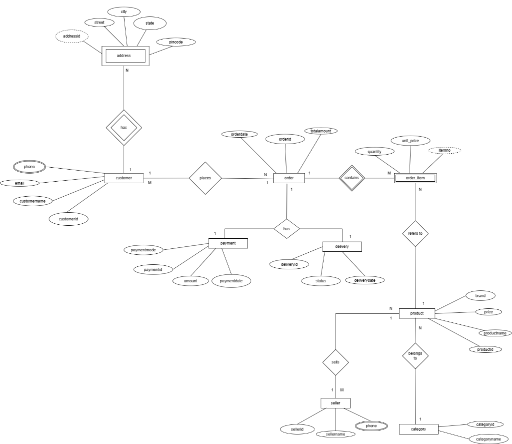
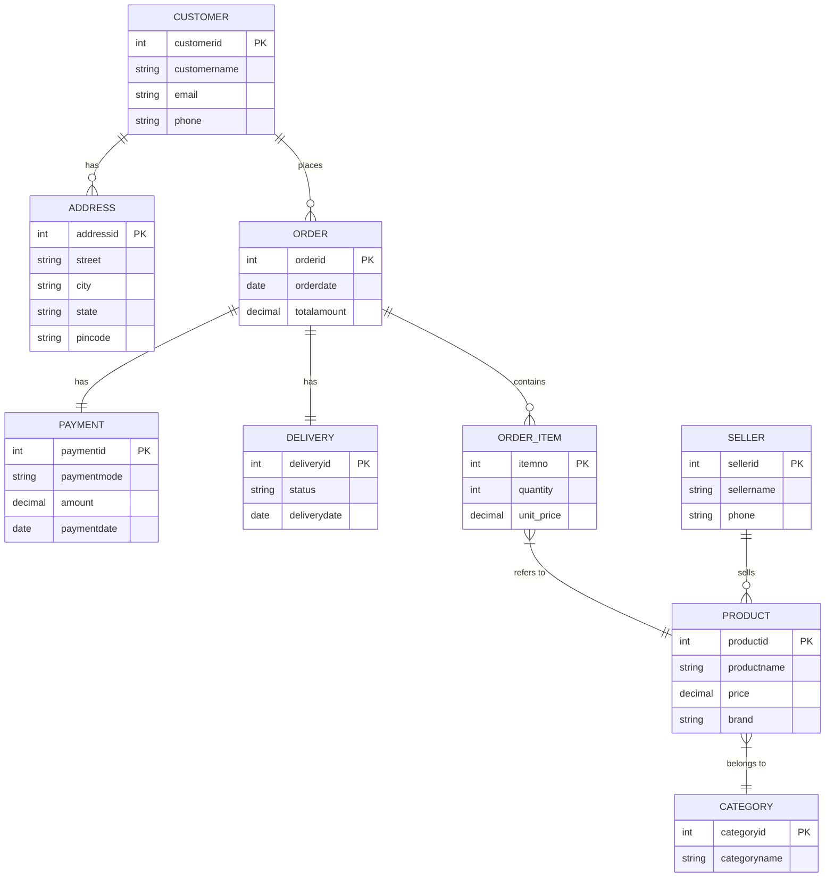

# Experiment 1: E-R (Entity-Relationship) Diagram Design

## 📌 Overview
This experiment contains the Entity-Relationship (ER) Diagram for an **E-Commerce Database System**.

- **Image File:** [`er_diagram.png`](./er_diagram.png)

---

## 🏬 Entities and Attributes

### 1. Customer
- **`customerid`** (Primary Key)
- `customername`
- `email`
- `phone` (Multivalued Attribute)

### 2. Address (Weak Entity)
- **`addressid`** (Partial Key / Discriminator)
- `street`, `city`, `state`, `pincode`

### 3. Order
- **`orderid`** (Primary Key)
- `orderdate`
- `totalamount`

### 4. Payment
- **`paymentid`** (Primary Key)
- `paymentmode`
- `amount`
- `paymentdate`

### 5. Delivery
- **`deliveryid`** (Primary Key)
- `status`
- `deliverydate`

### 6. Order_Item (Weak / Associative Entity)
- **`itemno`** (Partial Key / Discriminator)
- `quantity`
- `unit_price`

### 7. Product
- **`productid`** (Primary Key)
- `productname`
- `price`
- `brand`

### 8. Seller
- **`sellerid`** (Primary Key)
- `sellername`
- `phone` (Multivalued Attribute)

### 9. Category
- **`categoryid`** (Primary Key)
- `categoryname`

---

## 🔗 Relationships & Cardinalities

1. **Customer - Address**: `customer` **has** `address` (1 : N) *(Identifying Relationship for Weak Entity)*
2. **Customer - Order**: `customer` **places** `order` (1 : M / N : 1)
3. **Order - Payment**: `order` **has** `payment` (1 : 1)
4. **Order - Delivery**: `order` **has** `delivery` (1 : 1)
5. **Order - Order_Item**: `order` **contains** `order_item` (1 : M)
6. **Order_Item - Product**: `order_item` **refers to** `product` (N : 1)
7. **Seller - Product**: `seller` **sells** `product` (1 : M)
8. **Product - Category**: `product` **belongs to** `category` (N : 1)

---

## 📊 Mermaid Diagram Representation

